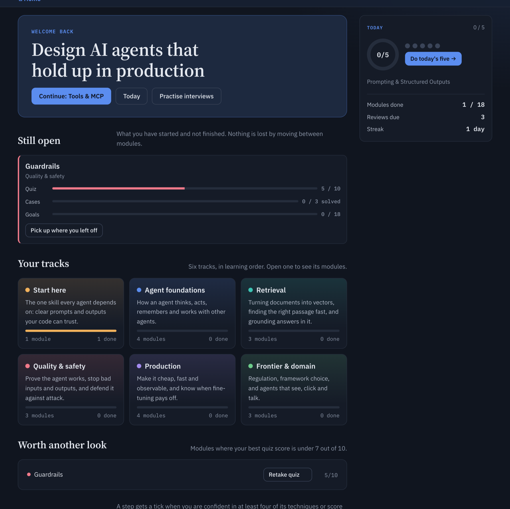
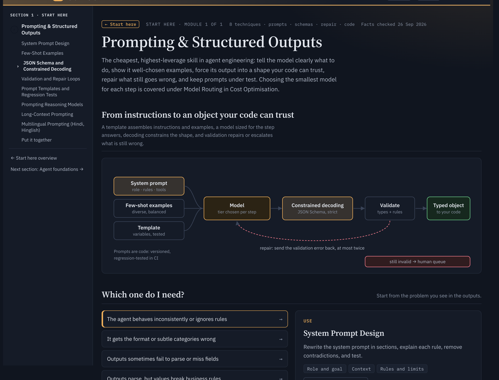
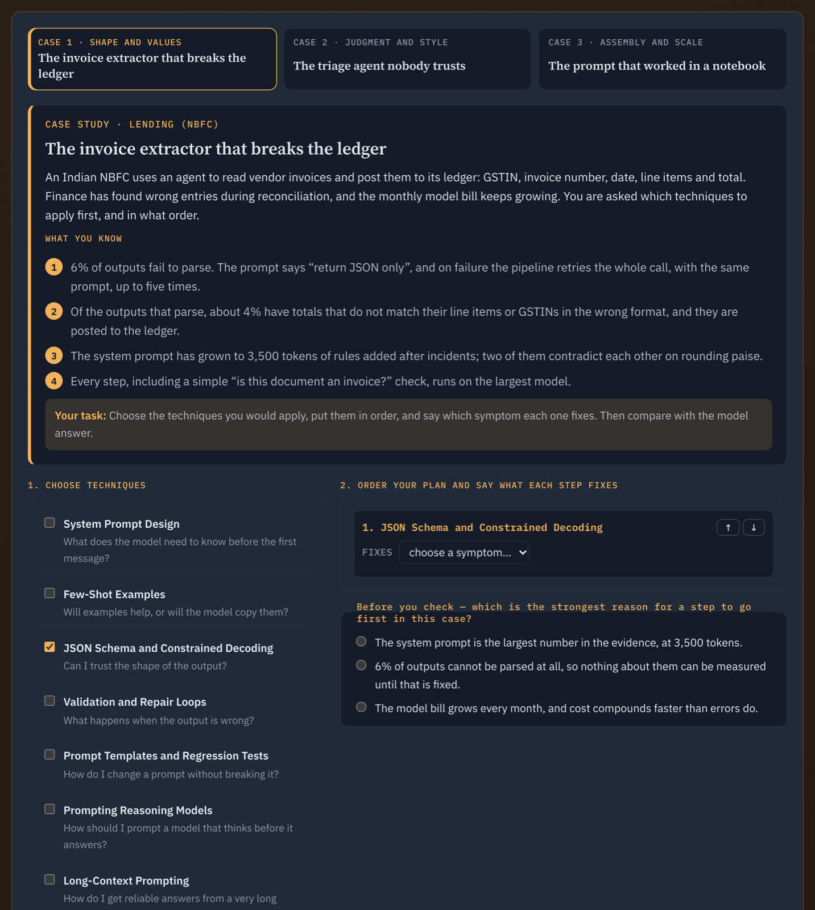
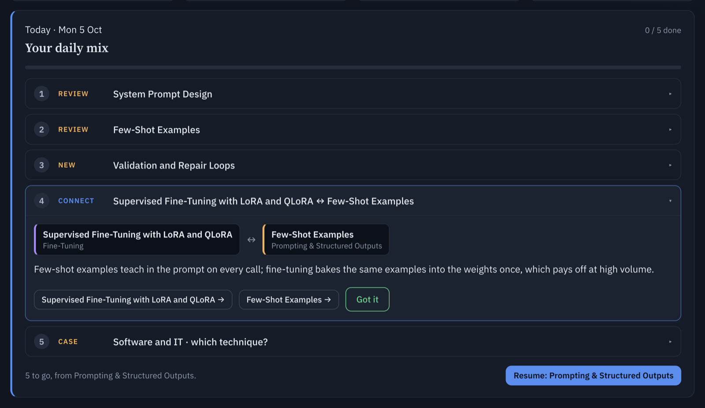
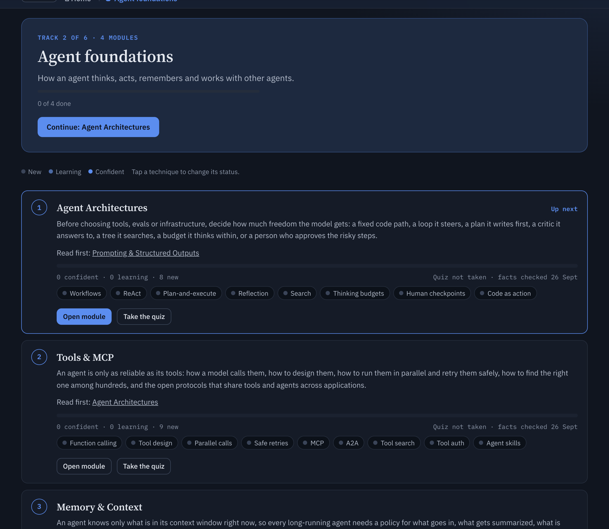
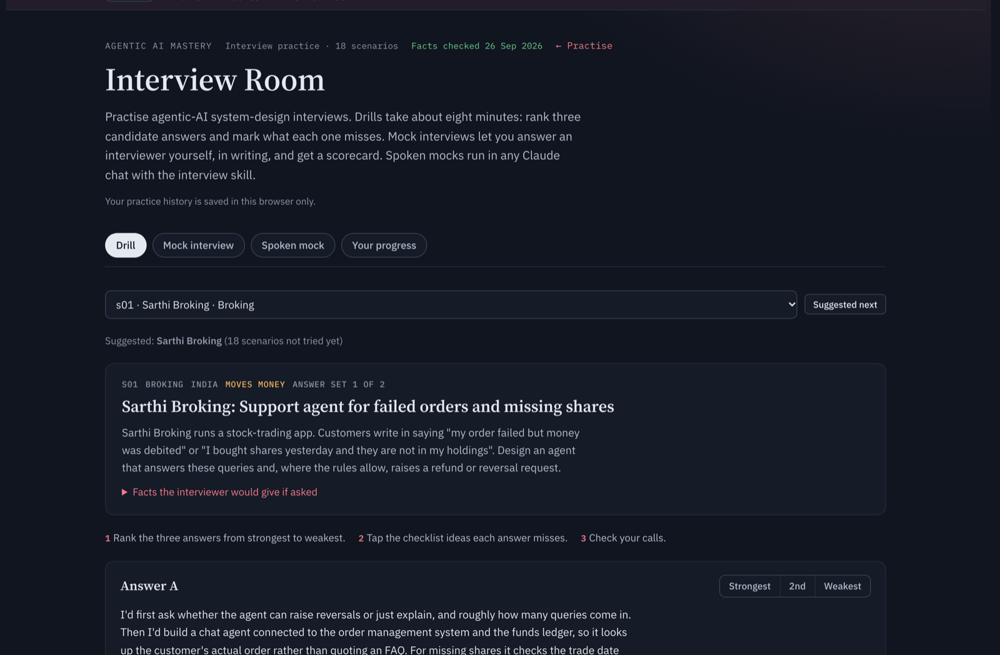
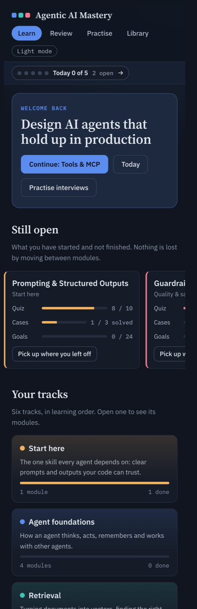

# Agentic AI Mastery

**A free, hands-on course for engineers who have to ship LLM agents that survive production — not demos.**

Agentic AI Mastery covers 18 modules and 145 techniques, taking you from your first structured prompt
through retrieval, evaluation, guardrails, cost and performance, and on to governance, framework choice
and computer-use agents. Every technique comes with a mechanism diagram, a runnable playground, real
code, the pitfalls that bite at scale, and a quiz. Every module ends with three capstone cases that are
deliberately set against each other, so you learn to *choose* techniques and defend the order rather than
reaching for the same one every time. The 163 case studies are drawn from real systems across 11 sectors —
many of them Indian banking, broking, lending, insurance and fintech — so the trade-offs are concrete
rather than hypothetical. An Interview Room adds 18 system-design scenarios scored on seven areas, with
every attempt kept so you can watch your weak spots move. The whole thing is a static site with no
backend, no accounts and no tracking: your progress lives in your browser, and syncs to your account only
when the site is opened inside a Claude artifact.



---

## Features

### 📚 18 modules across 6 tracks
- **Start here** — Prompting & Structured Outputs
- **Agent foundations** — Agent Architectures · Tools & MCP · Memory & Context · Multi-Agent Systems
- **Retrieval** — Embeddings · Vector Databases · RAG Pipelines
- **Quality & safety** — Evaluation · Guardrails · Agent Security
- **Production** — Cost Optimisation · Performance · AgentOps · Fine-Tuning
- **Frontier & domain** — Governance & Compliance · Choosing a Framework · Computer-Use & Voice Agents

### 🧪 A playground for every technique
145 interactive simulators — retrieval rankers, cost models, guardrail pipelines, agent loops — written as
**pure functions** with no DOM and no hidden randomness, so the same inputs always give the same output.
Change a parameter and watch the failure mode appear.

### 🎯 Capstones that make you decide
Three cases per module (54 in total). Pick the techniques, order them, say which symptom each one fixes,
then answer *why* anything goes first. A wrong plan gets escalating hints — level one asks about the
symptom, level two narrows the family, level three names the technique — never the answer outright.

### 📅 A daily mix, not a flashcard grind
Five mixed items a day: what spaced repetition says is due, something new, a **connection** between two
techniques from different modules (253 of them, the only thing that teaches how the pieces fit), and a
real case to diagnose. Items return on a 1 / 3 / 7 / 14-day schedule until they stick.

### 📊 Progress measured as evidence, not clicks
A module counts as done when you have **demonstrated** it — scored 7+ on the quiz *and* solved every
capstone case without revealing the answer. Opened cases, ticked goals and self-ratings are tracked
separately and never claim mastery on your behalf. Leave a module half-finished, start another, and both
stay listed with their own resume link.

### 🎤 Interview Room
18 system-design scenarios across regulated sectors. Rank candidate answers in an 8-minute drill, or sit
a written mock scored on requirements, architecture, agent-specific depth, evaluation, safety and
governance, cost and latency, and communication — with a scorecard, named fixes, and full attempt history.

### 📖 A searchable library
163 case studies filterable by industry, 371 glossary terms cross-linked into the modules, and 4 role-based
paths (AI engineer, product manager, architect, fintech engineer) that each pick a short route through the
course.

### ⚡ Static, private, fast
No backend, no sign-up, no analytics. Builds to a folder of static files you can host anywhere. Dark and
light themes, full keyboard navigation, and a layout that works from 390 px upward.

---

## Screenshots

### Modules teach one technique at a time


### Capstones: choose, order, defend


### Today's mix


### Track progress


### Interview Room


### On a phone


---

## Quick start

```bash
npm install
npm run dev        # http://localhost:5173
npm run check      # typecheck + content validation + 1400 tests  (~15s)
npm run build      # static bundle in dist/ — deploy anywhere
```

No environment variables and no services to run.

---

## Architecture

Layered, with dependencies pointing inward: `presentation` and `infrastructure` depend on `application`,
which depends on `domain`. Domain depends on nothing.

| Path | Purpose |
| --- | --- |
| `src/domain` | Contracts: content schema, playground spec, progress port. No dependencies on other layers. |
| `src/application` | Use cases: registry, playground session, progress, quiz grading. |
| `src/infrastructure` | Adapters: browser storage, Claude artifact storage, in-memory. |
| `src/presentation` | Views, renderers, the hash router and styles. |
| `src/modules/*` | 18 feature folders: content, pure simulators, playground definitions. |
| `src/content/site` | The course itself — hub, module JSON and per-module CSS. |
| `tests/` | Unit, contract and rendering tests (1400 of them). |
| `scripts/` | Content validation and legacy migration. |
| `docs/ARCHITECTURE.md` | Diagrams, patterns and the guide to adding a module. |

**Two things to know before contributing.** Features are switched on by *content*, never by slug: adding
`cx.cases` to a module turns on the multi-case capstone, and rollback is deleting a key — `if (slug === 'eval')`
anywhere in `src/presentation` is a bug. And the content files are the expensive part: module JSON is
~350 KB minified onto a single line, so query it with a script rather than reading it whole.

`SKILLS.md` holds the working notes for anyone picking this up. Everything in it is either a measured cost
or a bug that has already shipped once.

---

## Tech stack

TypeScript 5.6 · Vite 7 · Vitest 3 + jsdom. Runtime dependencies are `zod` for content validation and
`highlight.js` for code samples — that is the entire list.

---

## Licence

Not yet specified.
