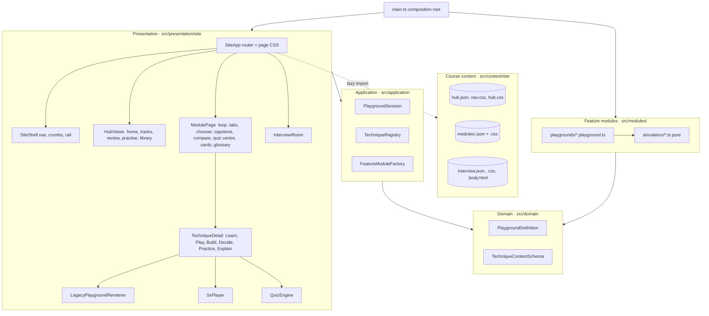
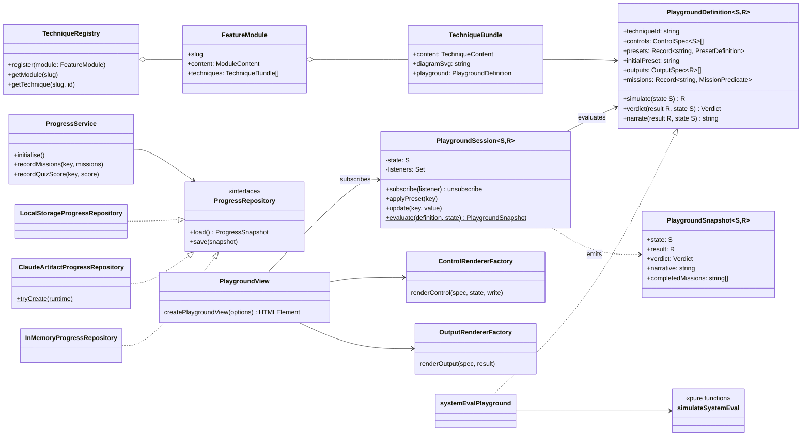
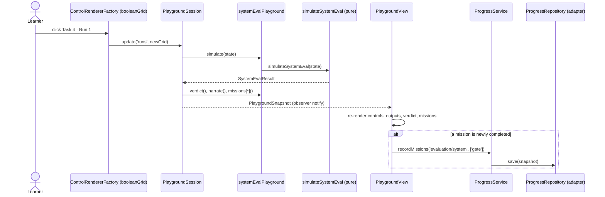
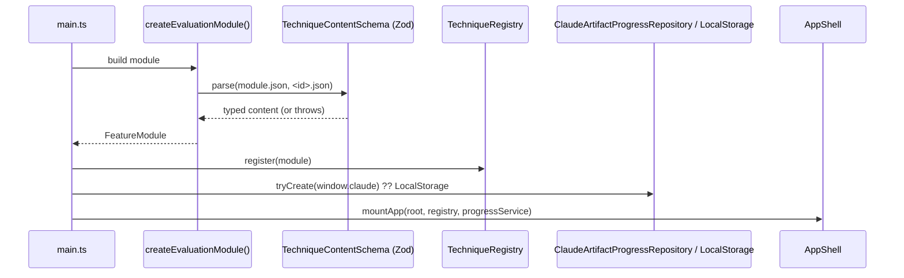

# Agentic AI Mastery v2: architecture

This document describes the target architecture and the first migrated feature, **Module 1: Evaluation**
(9 techniques). Every other module follows the same pattern.

## 1. Goals and principles

| # | Goal | How the design meets it |
|---|------|------------------------|
| 1 | Clean architecture | Four layers (domain, application, infrastructure, presentation). Dependencies point inward only; the domain imports nothing from outer layers. |
| 2 | System design | Static site with a build-time content pipeline, schema validation as a gate, pluggable persistence, CI quality gates. |
| 3 | Design patterns | Registry, Observer, Factory + Strategy, Adapter, Port/Repository, Composition Root, Declarative Specification. |
| 4 | Naming conventions | See section 8. |
| 5 | Independently testable | Simulators are pure functions; use cases depend on ports; views depend on specs. Each is tested alone. |
| 6 | Modular design | Each study module is a vertical slice under `src/modules/<slug>` with its own content, simulators and playgrounds. |
| 7 | Extensible | New module, technique, control kind or storage backend = add files, register once. No edits to existing features. |
| 8 | Common code segregated | `shared/` (pure helpers), `domain/` (contracts), `presentation/` (generic renderers) are reused by every module. |

## 2. Layered view



Rule: an arrow means "imports". Nothing in `domain/` imports from `application/`, `presentation/` or `modules/`.

### 2.1 Presentation: the course site

The site reproduces the course pages exactly: the same markup and the same stylesheets as the original site, so
every page looks and behaves as before. What changed is underneath:

- **Content is data.** `scripts/extract-legacy-site.mjs` (an anti-corruption script) runs each original module page
  once in jsdom and saves its content as JSON: techniques, lessons with every animation frame pre-rendered to SVG,
  diagrams, decide and practice data, quiz banks, capstone, mentor questions and the glossary. Module JSON and CSS are
  lazy-loaded per page.
- **Playgrounds are declarative.** Every Play tab is a `PlaygroundDefinition` from `src/modules/<slug>` driven by a
  `PlaygroundSession`. `LegacyPlaygroundRenderer` renders any definition with the course's playground markup
  (`.pl-grid`, `.pl-btns`, `.togs`, `.rng`, meter rows, `.kv`, verdicts); one strategy per control and output kind.
- **Markup is built through one helper.** `html` tagged templates escape every interpolated value; only build-time
  course content is passed through `trusted()`. `setHtml` is the single place markup enters the DOM.
- **Small, single-purpose views.** Each technique pane is its own file with an `…HTML()` builder and a `wire…()`
  function for behaviour; the module page passes a `ModuleContext` instead of using globals.
- **Two carried-over engines.** The "See it run" scenes for Agent Architectures and the Interview Room logic are
  kept verbatim inside module boundaries (`modules/architectures/scenes/sxScenes.ts`,
  `presentation/site/interview/interviewRoom.ts`, both `@ts-nocheck`). They are the next candidates for a typed rewrite.

## 3. Low-level design: the Evaluation feature

> The domain and application parts below are current. The presentation classes shown in the diagrams (AppShell, TechniquePage, PlaygroundView and the control/output factories) were replaced by the course site described in section 2.1.

### 3.1 Folder structure

```
src/
├── shared/format.ts                       # pure formatters: ₹, %, counts, joinWithAnd
├── domain/
│   ├── playground/PlaygroundDefinition.ts # ControlSpec, OutputSpec, Verdict, PlaygroundDefinition<S,R>
│   ├── technique/TechniqueContent.ts      # Zod schemas + inferred types (single content contract)
│   ├── technique/FeatureModule.ts         # FeatureModule, TechniqueBundle
│   └── progress/Progress.ts               # ProgressRepository port + value types
├── application/
│   ├── TechniqueRegistry.ts               # Registry pattern
│   ├── PlaygroundSession.ts               # Observer pattern; pure evaluate()
│   ├── ProgressService.ts                 # use cases over the repository port
│   └── QuizGrader.ts                      # pure grading use case
├── infrastructure/progress/
│   ├── LocalStorageProgressRepository.ts  # Adapter: browser storage
│   ├── ClaudeArtifactProgressRepository.ts# Adapter: Claude artifact db (factory tryCreate)
│   └── InMemoryProgressRepository.ts      # Adapter: tests
├── modules/evaluation/                    # ← the feature slice
│   ├── content/
│   │   ├── module.json                    # glossary, sources, symptom router, technique order
│   │   ├── <techniqueId>.json             # one file per technique, validated by the schema
│   │   └── diagrams/<techniqueId>.svg
│   ├── simulators/<name>.ts               # pure domain logic, typed State → Result
│   ├── playgrounds/<name>.playground.ts   # declarative PlaygroundDefinition per technique
│   └── index.ts                           # createEvaluationModule(): wires content ↔ playgrounds
├── presentation/
│   ├── dom.ts                             # safe element builder, trustedSvg()
│   ├── controls/ControlRendererFactory.ts # Factory + Strategy per ControlSpec kind
│   ├── outputs/OutputRendererFactory.ts   # Factory + Strategy per OutputSpec kind
│   ├── components/                        # AppShell, TechniquePage, PlaygroundView, LessonView, QuizView
│   ├── router/HashRouter.ts
│   └── styles/                            # tokens.css, app.css, diagrams.css
└── main.ts                                # composition root
```

### 3.2 Class diagram



### 3.3 Sequence: a learner flips a cell in the System-Level Eval playground



### 3.4 Start-up sequence



### 3.5 Data contracts

| Contract | File | Validated by |
|---|---|---|
| Technique content | `domain/technique/TechniqueContent.ts` (`TechniqueContentSchema`) | `npm run validate` (build gate), module load, tests |
| Module content | same file (`ModuleContentSchema`) | same |
| Playground behaviour | `domain/playground/PlaygroundDefinition.ts` | TypeScript + `playgroundContracts.test.ts` |
| Progress | `domain/progress/Progress.ts` | `application.test.ts` |

## 4. Design patterns used

| Pattern | Where | Why |
|---|---|---|
| Registry | `TechniqueRegistry` | Modules register explicitly; no globals, duplicates fail fast. |
| Observer | `PlaygroundSession.subscribe` | Views re-render from immutable snapshots; logic stays out of the view. |
| Factory + Strategy | `ControlRendererFactory`, `OutputRendererFactory` | One renderer per kind; adding a kind never touches playgrounds. |
| Declarative specification | `PlaygroundDefinition` | A technique is data plus pure functions; one generic view renders all of them. |
| Port and Adapter (Repository) | `ProgressRepository` + 3 adapters | Storage can change (browser, Claude db, tests) without touching use cases. |
| Factory method | `ClaudeArtifactProgressRepository.tryCreate` | Encapsulates capability detection and fallback. |
| Composition root | `main.ts` | The only place concrete classes are chosen. |
| Anti-corruption layer | `scripts/migrate-legacy.mjs` | Translates the legacy global-object files into the new schema once. |

## 5. Quality gates

```
npm run check   =  typecheck  →  validate (content schema)  →  test (vitest)
npm run build   =  validate   →  vite build
```

Contract tests (`tests/modules/evaluation/playgroundContracts.test.ts`) run for **every** playground:

1. Each preset produces the numbers it declares in `expected`, so learner-facing copy cannot drift from the maths.
2. The initial preset completes no mission.
3. Preset keys and mission keys match the content guide.
4. Every preset yields a verdict and a narrative.

## 6. How to extend

### 6.1 Add a technique to an existing module
1. Add `src/modules/<slug>/content/<id>.json` (copy an existing file; `npm run validate` tells you what's missing).
2. Add `simulators/<name>.ts`: a pure `simulate<Name>(state): result` with exported `State` and `Result` types.
3. Add `playgrounds/<name>.playground.ts` using `definePlayground<State, Result>({...})` with presets that declare `expected` values.
4. Add the id to `content/module.json → techniqueOrder` and to the module's `PLAYGROUNDS` map in `index.ts`.
5. `npm run check`. The contract tests pick up the new playground automatically.

### 6.2 Add a new module (feature slice)
1. Run the migration for that module: `LEGACY_DIR=../panels MODULE=2 SLUG=guardrails npm run migrate:legacy`.
2. Create `src/modules/guardrails/{simulators,playgrounds,index.ts}`. `index.ts` exports a `<SLUG>_PLAYGROUNDS` map and a
   `create<Slug>Module()` that calls `buildFeatureModule({ title, moduleJson, contentFiles, diagramFiles, playgrounds })`
   from `application/FeatureModuleFactory.ts`; the factory validates the content and checks each playground's `techniqueId`.
3. Register it in `main.ts`: `.register(createGuardrailsModule())`.
4. Add the playground map to `MODULES` in `tests/modules/shared/playgroundContracts.test.ts`; every contract runs on it.

### 6.2a Shared code
- `shared/format.ts`: Indian-grouped counts and rupees, percentages, plurals.
- `shared/flags.ts`: `flagsFrom` / `enabledKeys` for checklist state used with the `flagSet` control.
- `shared/random.ts`: `seededRandom` (Park–Miller, same sequence as the legacy site) and `gaussian`.
- `shared/statistics.ts`: `normalCdf`.
- When several lessons share one simulator, write a playground factory (see `modules/frameworks/playgrounds/createChooserPlayground.ts`).

### 6.3 Add a new control or output kind
1. Add a union member to `ControlSpec` or `OutputSpec` in `domain/playground/PlaygroundDefinition.ts`.
2. Add one renderer to the map in `ControlRendererFactory.ts` or `OutputRendererFactory.ts`. TypeScript refuses to compile until you do.

Output kinds today: `meter`, `value`, `check`, `badges`, `table`, `itemList` (judged inputs with a status and tone) and `code` (a preformatted block, such as a query plan). Control kinds: `select`, `choice`, `steps`, `toggle` (optionally `isEnabled`), `flagSet`, `booleanGrid`, `sequence` and `note`.

### 6.4 Add a storage backend
Implement `ProgressRepository` in `infrastructure/progress/` and choose it in `main.ts`.

## 7. Testing strategy

| Level | What | Tool | Example |
|---|---|---|---|
| Unit (domain) | Simulators: pure input → output | Vitest | `simulators.test.ts` |
| Contract | Every playground definition vs its content guide | Vitest | `playgroundContracts.test.ts` |
| Unit (application) | Session, registry, progress, grading with in-memory adapters | Vitest | `application.test.ts` |
| Content | Schema + cross-references | Zod via `npm run validate` | build gate |
| Smoke (UI) | Every tab and preset renders without console errors; 390 px width without horizontal scroll | Playwright (to add to CI) | see README |

## 8. Naming conventions

| Thing | Convention | Example |
|---|---|---|
| Folders | kebab or lowercase, plural for collections | `simulators/`, `playgrounds/` |
| Classes, interfaces, types | PascalCase, noun | `PlaygroundSession`, `ProgressRepository` |
| Ports | noun describing the capability | `ProgressRepository` |
| Adapters | `<Technology><Port>` | `LocalStorageProgressRepository` |
| Pure functions | verbNoun, camelCase | `simulateSystemEval`, `gradeAnswer` |
| Factories | `create<Thing>` / `tryCreate` | `createEvaluationModule`, `createPlaygroundView` |
| Playground definitions | `<technique>Playground` in `<technique>.playground.ts` | `systemEvalPlayground` |
| State and result types | `<Technique>State`, `<Technique>Result` | `PairwiseState` |
| Constants | UPPER_SNAKE_CASE | `RELEASE_GATE_THRESHOLD` |
| Booleans | `is`/`has`/verb-past | `isCorrect`, `gatePasses`, `regressionDetected` |
| Units in names | suffix the unit | `suiteCostRupees`, `marginPoints`, `costPerRun` |
| Tests | `<subject>.test.ts`, describe the behaviour | `it('starts on a preset that completes no mission')` |

## 9. Architecture decision records

- **ADR-001 Framework-free presentation.** A small safe DOM builder plus generic renderers keeps the bundle small and the views trivially testable with jsdom. Revisit if the UI grows interactive state beyond playgrounds (then Preact or Svelte behind the same view functions).
- **ADR-002 Declarative playgrounds.** The legacy site had ~150 hand-written playgrounds repeating the same render → update → emit loop. Specs + one generic view remove that duplication; behaviour is still code (pure functions), not stringly-typed config.
- **ADR-003 Zod schemas in the domain.** Types are inferred from the schema so the content contract exists once. Zod is treated as a domain-level validation library.
- **ADR-004 Trusted SVG only.** All user-visible text goes through `textContent`. Diagrams are build-time assets parsed by `trustedSvg`, which also strips scripts and event attributes.
- **ADR-005 Persistence behind a port.** Progress uses Claude artifact storage when available and falls back to browser storage; tests use the in-memory adapter.
- **ADR-006 Migration through an anti-corruption script.** Legacy files are read once by `scripts/migrate-legacy.mjs`; nothing at runtime depends on them.

## 10. Known limitations and next steps

- Lesson scenes and diagrams are migrated as static SVG markup. Next: express them as a `DiagramSpec` (chips, boxes, arrows) rendered by a `DiagramRenderer`, so they become editable data too.
- Mentor, teach-back, predict-the-step and debug exercises from the legacy site are not migrated yet; their content types are the next schema additions.
- Playwright smoke tests are run manually; add them to CI.
- All 18 modules are migrated: 146 playgrounds, each covered by the contract tests.
- Some Play tabs show the same numbers, controls and verdicts as the original but with the generic layout instead of a playground's custom visual (for example a ranked list or a drawn graph). Add an output kind or a per-playground view where the original visual matters.
- `src/modules/<slug>/content/*.json` (validated technique content) and `src/content/site/modules/*.json` (page content) overlap; the site reads the latter, the contract tests the former. Merge them into one schema next.
